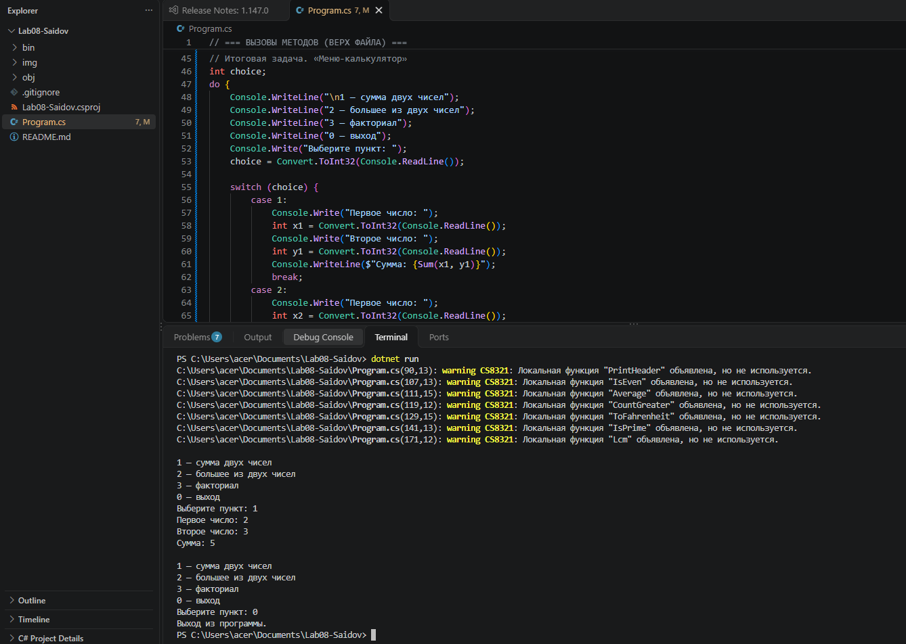
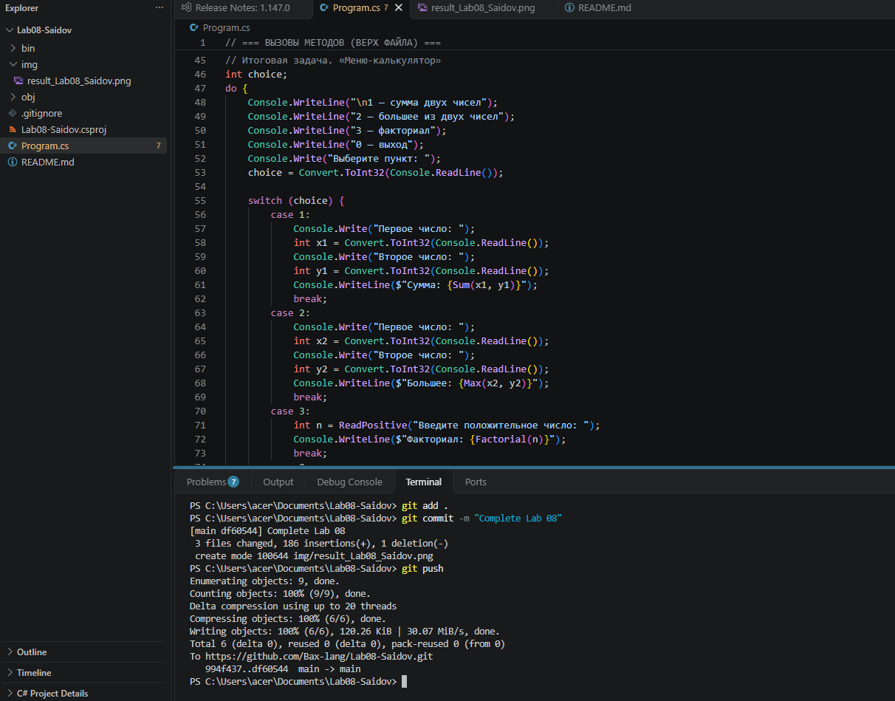

# Практическая работа №8

**ФИО:** Саидов Бахмуд Мирзаевич
**Группа:** ИСП-243
**Дата:** 21.11.2026

## Что изучено
- Метод `void` просто выполняет набор команд внутри себя и ничего не возвращает обратно, а метод с типом данных (например, `int` или `bool`) обязан вернуть результат через ключевое слово `return`.
- Параметры в скобках позволяют передавать в метод разные входные данные при каждом вызове, не переписывая один и тот же код.
- Вынесение повторяющихся действий в отдельные методы делает программу короче, понятнее и позволяет исправлять логику в одном месте вместо нескольких.

